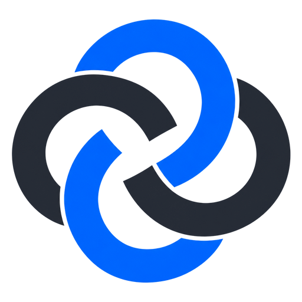
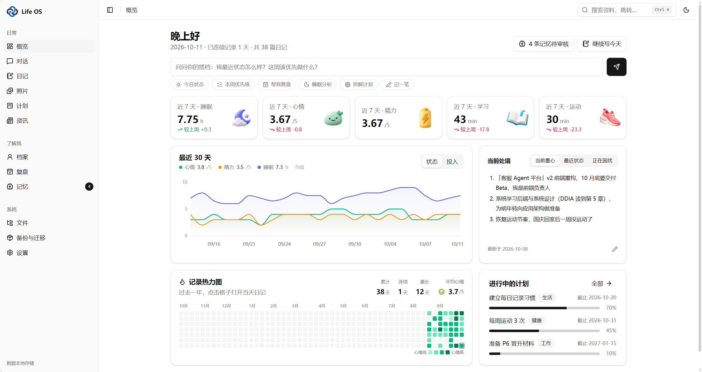
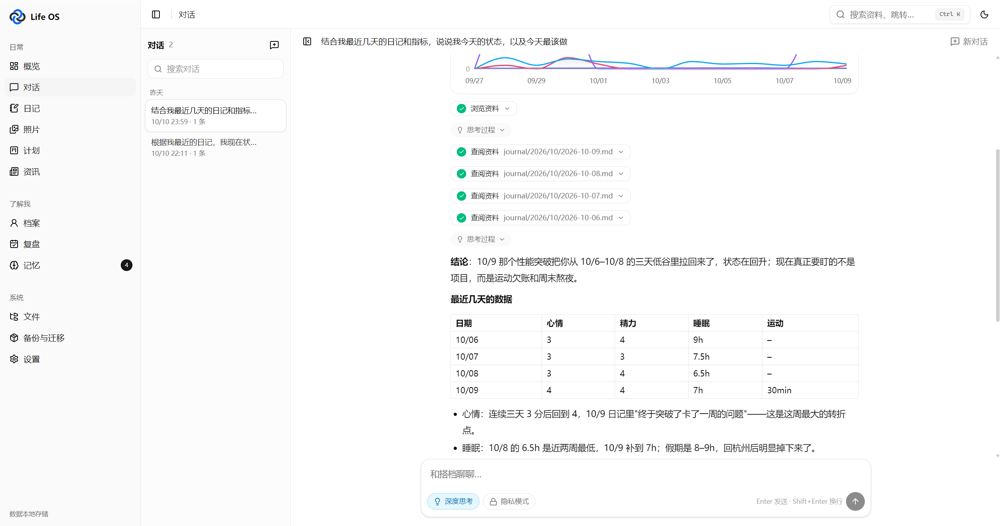
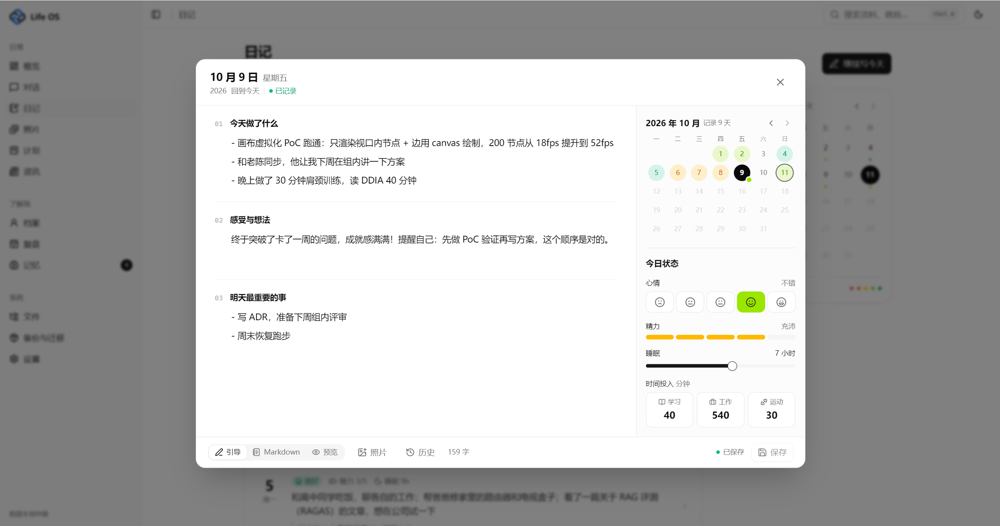
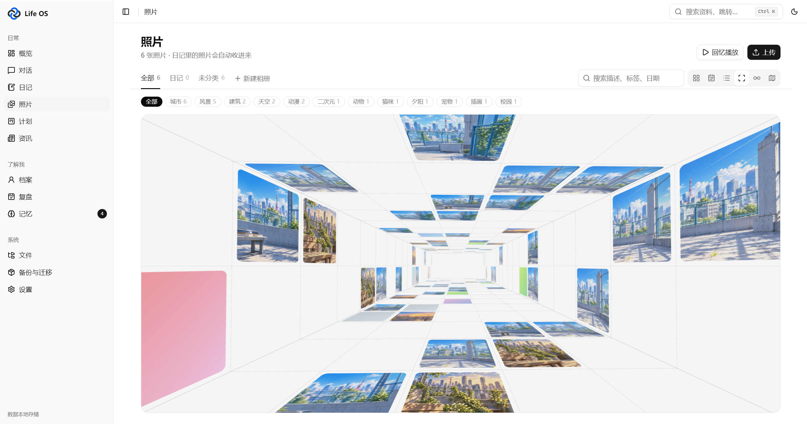
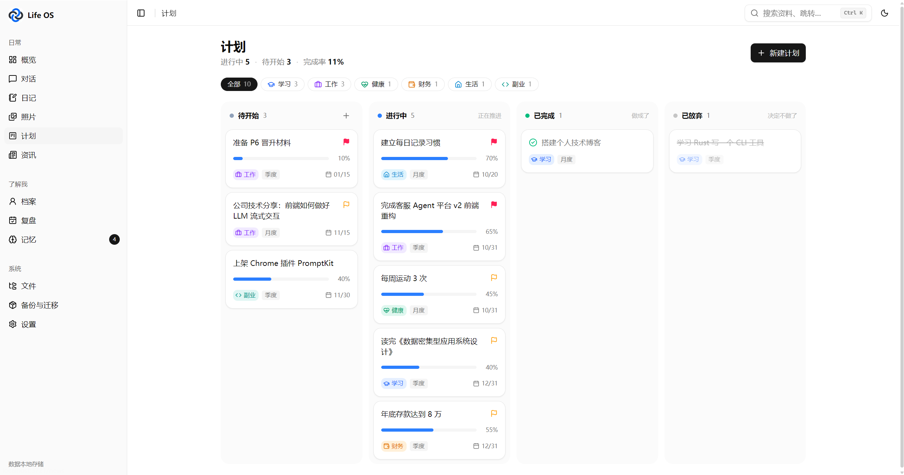
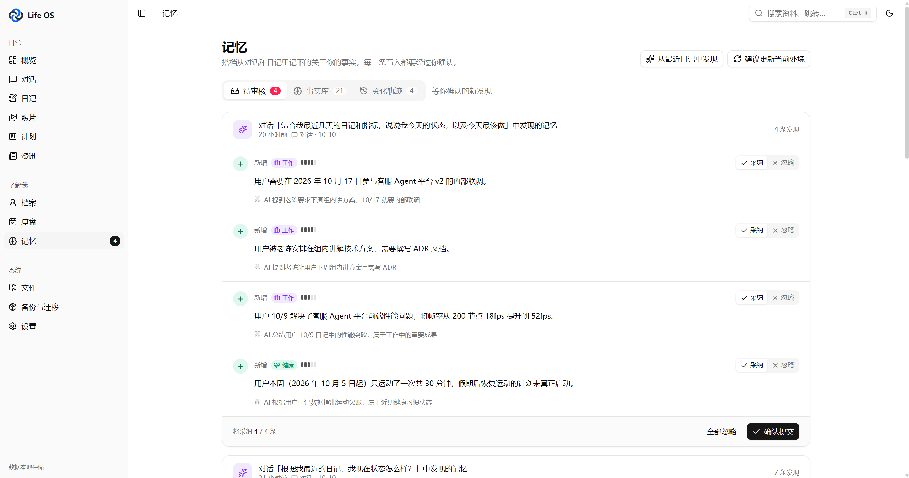
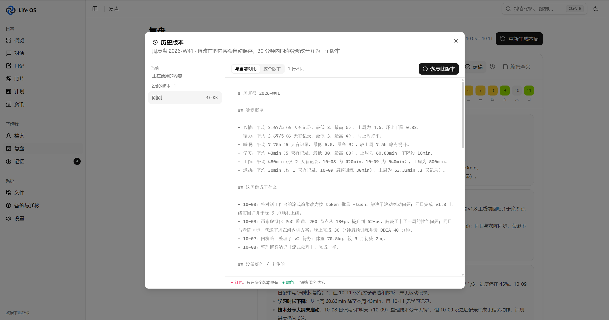
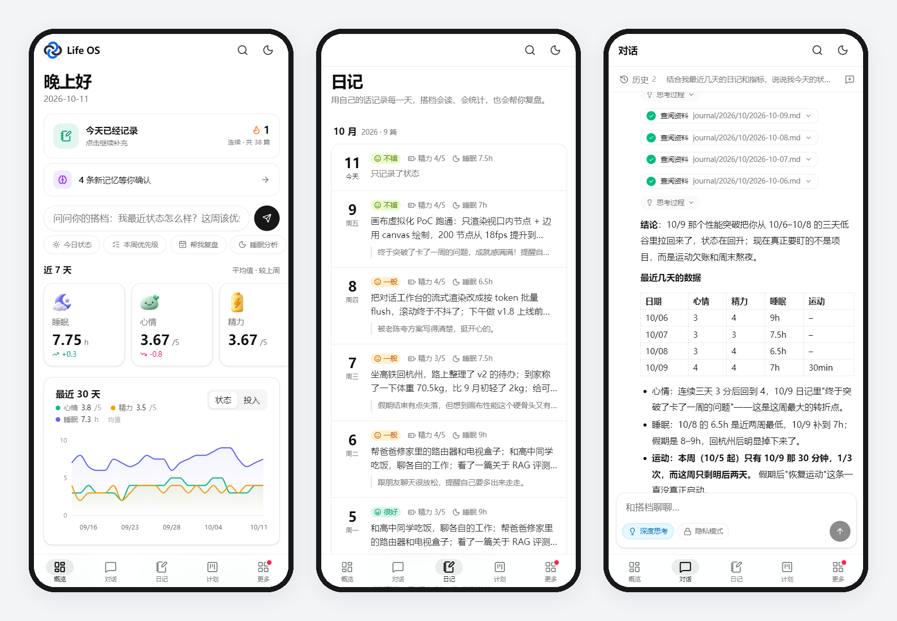

<div align="center">



# Life OS

**一个真正了解你的 AI 搭档。**<br/>
日记、计划、健康、记忆都存成本地 Markdown，AI 读得懂，你也随时带得走。

<p>
  <a href="LICENSE"></a>
  
  
  <a href="https://github.com/c-Xcan/life-os/releases"></a>
</p>

[快速开始](#快速开始) · [功能](#功能) · [桌面版](#桌面版) · [数据与隐私](#数据与隐私) · [架构](#架构)



</div>

## 为什么做这个

和 AI 聊天时，每次都要重新交代背景：最近在忙什么、身体怎么样、目标是什么。聊完它又全忘了。

Life OS 换了个思路：**把你的生活持续写进一个文件夹**。你写日记、记计划，或者直接跟 AI 说今天发生了什么；它会整理出关于你的事实、记住你的偏好、每周帮你复盘。下次再聊，它已经知道你的处境。

- **数据是你的**：所有内容都是普通 Markdown 文件，用 Obsidian、VS Code 都能打开，换工具也不怕。
- **记忆要你点头**：AI 发现的新事实先进审核箱，你确认后才写入，不会自己乱记。
- **模型随你换**：默认 DeepSeek，任何 OpenAI 兼容接口都能接，也可以用 Ollama 跑本地模型。

## 功能

### 💬 对话：带着上下文的 AI 搭档

每次对话都会自动带上你的近况、相关日记和记忆。它能查日记、改计划、记一笔，写操作前会先弹出确认卡片。



### 📔 日记：每天几分钟，记下状态和经历

按月份浏览近期日记，在弹窗里写新的一篇。睡眠、心情、精力、学习、运动这些指标会自动画成趋势图；还可以插入当天的照片。



### 🖼️ 照片：日记里的照片自动归档

瀑布流、时间线、列表、地图，还有隧道、丝带两种沉浸式浏览，可以分相册、批量整理。日记里的照片单独成类，点开就能看到当天的日记。



### 🗂️ 计划 · 复盘 · 记忆

| 计划看板 | 记忆审核 |
|---|---|
|  |  |

- **计划**：按“待开始 / 进行中 / 已完成 / 已放弃”看板管理目标，带进度、领域和截止时间。
- **复盘**：每周自动生成复盘草稿，你改完再保存。
- **记忆**：AI 从对话和日记里提取事实，新增、更新还是作废由你决定；旧事实不会删除，能看到自己的变化轨迹。
- **档案**：`now.md` 记录你的近况，“我是谁”描述长期背景，这是 AI 理解你的起点。
- **资讯**：订阅感兴趣的信息源，按你的关注点筛选，并翻译成中文摘要。

### 🕰️ 历史版本与回收站

每次修改前自动保存旧版本，可以逐行对比、一键恢复；删掉的文件 30 天内都能找回。不依赖 git，开箱即用。



### 📱 手机上也好用

专门为手机重新排版：底部标签栏、可滑动的指标卡片、全屏写日记。

<div align="center">

</div>

## 快速开始

### 方式一：下载桌面版

到 [Releases](https://github.com/c-Xcan/life-os/releases) 下载安装包（Windows `.exe` / macOS `.dmg`），装好打开，选择一个数据文件夹即可。

### 方式二：从源码运行

需要 **Node.js ≥ 22.13**（推荐 24 LTS）。

```bash
git clone https://github.com/c-Xcan/life-os.git
cd life-os
npm install
npm run dev
```

打开 http://localhost:3721 ，然后：

1. 到 **设置** 填入 DeepSeek API Key（或添加其他模型服务商），点“测试”。
2. 到 **档案** 写下你的近况和“我是谁”。
3. 开始写日记，或者直接在 **对话** 里告诉它今天发生了什么。

> 国内网络 `npm install` 慢的话，先执行 `npm config set registry https://registry.npmmirror.com`。

### 可选：本地语义检索

安装 [Ollama](https://ollama.com) 后执行 `ollama pull bge-m3`，系统会自动给资料计算向量，实现语义检索。没装也能用，会自动退回关键词检索。

## 桌面版

桌面版把网页版打包成独立应用，数据仍然是一个普通文件夹。

- **托盘常驻**：关掉窗口留在后台，定时整理照常运行。
- **全局快捷键**：任意位置按 `Ctrl+Shift+J`（Mac `⌘⇧J`）打开今天的日记。
- **系统通知**：新记忆待审核、复盘草稿生成、晚上还没写日记时提醒你。
- **开机自启、更换数据文件夹、自动检查更新**，都在 设置 → 桌面版 里。

<details>
<summary>自己打包桌面版</summary>

```bash
# 国内网络建议先设置 Electron 镜像（PowerShell 用 $env:ELECTRON_MIRROR="..."）
export ELECTRON_MIRROR=https://npmmirror.com/mirrors/electron/
export ELECTRON_BUILDER_BINARIES_MIRROR=https://npmmirror.com/mirrors/electron-builder-binaries/
npm install

npm run desktop:check      # 确认 Electron 自带的 Node 支持 node:sqlite
npm run dev                # 开发：先启动网页服务
npm run desktop:dev        # 再用桌面窗口打开它

npm run desktop:build:win  # Windows → dist-desktop/Life-OS-Setup-x.y.z.exe
npm run desktop:build:mac  # macOS   → dist-desktop/Life-OS-x.y.z-arm64.dmg / -x64.dmg
```

- 首次启动会让你选择数据文件夹；选原来的项目文件夹即可沿用网页版的数据（不要同时开着网页版和桌面版）。
- 运行日志：Windows `%APPDATA%\Life OS\logs\server.log`，Mac `~/Library/Logs/Life OS/server.log`。
- Mac 安装包未签名：首次打开请在“访达”里右键 → 打开。

</details>

## 数据与隐私

- **全部存在本机**：数据就是 `vault/` 里的 Markdown 文件，加上 `.app/` 里的设置和索引，不上传到任何服务器。只有对话时，相关内容会发给你配置的模型服务商。
- **私密内容不出本机**：标记为 `private: true` 的文件默认不发给云端模型；开启隐私模式后，改用本地模型处理。
- **API Key 只存本机**：保存在 `.app/secrets.json`，备份时也不会打包进去。
- **桌面版只接受自己窗口的请求**：本地服务每次启动生成随机令牌，电脑上的其他程序访问不到你的数据。
- **随时带走**：在 备份与迁移 页可以导出完整 zip，也可以直接导入另一个 vault 文件夹。
- **其他 AI 工具也能用**：`vault/README.ai.md` 是写给 AI 的说明书，在 Claude Code、Cursor、Codex 里打开 `vault/` 就能直接读写，格式也兼容 Obsidian。

## 架构

```
界面层  Next.js + shadcn/ui（网页 / 手机 / Electron 桌面）
   │
Agent   OpenAI 兼容模型适配（DeepSeek / Kimi / 通义 / Ollama…，按角色分配）
运行时  上下文组装 → 推理 ⇄ 工具调用 → 流式输出；写操作需确认；技能（SKILL.md）
   │
记忆    工作记忆 now.md · 情景记忆 journal/ sessions/ · 语义记忆 memory/facts/ · 程序记忆 skills/
系统    抽取 → 比对（新增 / 更新 / 作废）→ 审核箱 → 写入；定时整理（周复盘、刷新 now.md）
   │
数据层  vault/*.md（唯一真实数据）
        .app/index.db（SQLite：FTS5 全文 + 向量 + 指标 + 事实，可随时删除重建）
        .app/history/ · .app/trash/（历史版本与回收站）
```

<details>
<summary>目录结构与设计说明</summary>

| 路径 | 说明 |
|---|---|
| `vault/` | 你的数据。首次运行时由 `vault-template/` 初始化 |
| `.app/` | 运行状态：设置、API Key、索引、会话、待审核记忆、运行轨迹、历史版本、回收站 |
| `vault-template/` | vault 规范与模板 |
| `src/lib/vault` | Markdown 读写、frontmatter 规范、历史版本与回收站 |
| `src/lib/index` | SQLite 索引、混合检索、向量 |
| `src/lib/llm` | OpenAI 兼容客户端（流式、工具调用、DeepSeek 思考模式） |
| `src/lib/agent` | Agent 循环、工具、上下文组装、技能、会话、轨迹 |
| `src/lib/memory` | 记忆抽取 / 比对 / 审核 / 整理 / 调度 |
| `src/lib/backup` | 完整备份与导入 |
| `desktop/` | Electron 主进程、托盘、打包脚本 |

- **Markdown 是唯一真实数据**：索引和向量都是派生数据，删掉 `.app/index.db` 会自动重建。
- **对缓存友好**：系统提示按“稳定 → 变化”排列，每轮的检索结果附在用户消息上，能充分利用 DeepSeek 的前缀缓存。
- **模型按角色分配**：对话（主 Agent）、后台（记忆抽取、复盘，建议用便宜模型）、嵌入（向量检索）、隐私（本地模型），在 设置 → 模型角色 里分别指定。

</details>

## 开发

```bash
npm run dev          # 开发模式
npm run build && npm start   # 生产模式
npm run typecheck    # 类型检查
npm run test:e2e     # 端到端测试（使用临时目录，不碰你的数据）
npm run reindex      # 命令行重建索引和向量
```

## 许可协议

[MIT](LICENSE)
